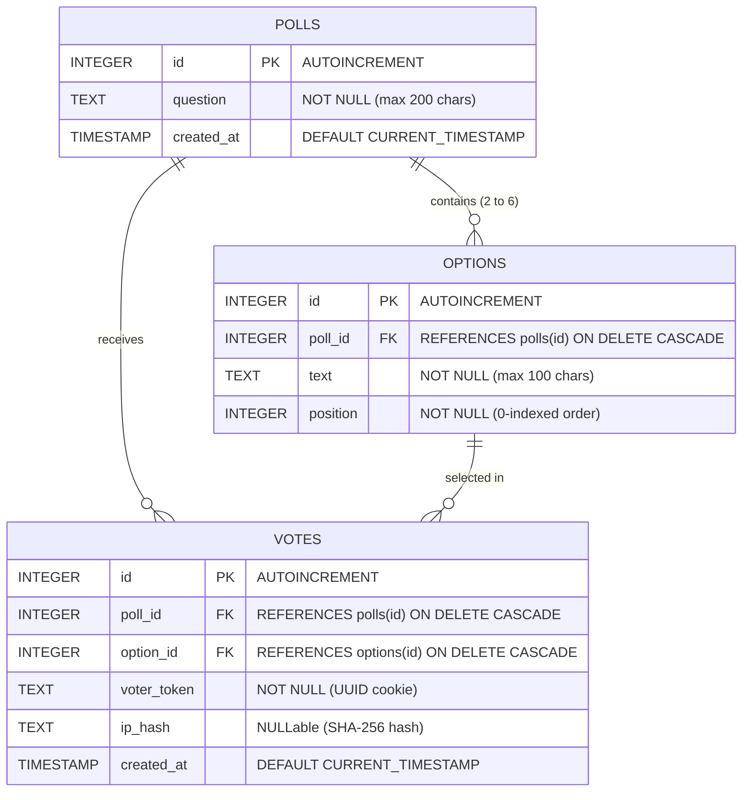
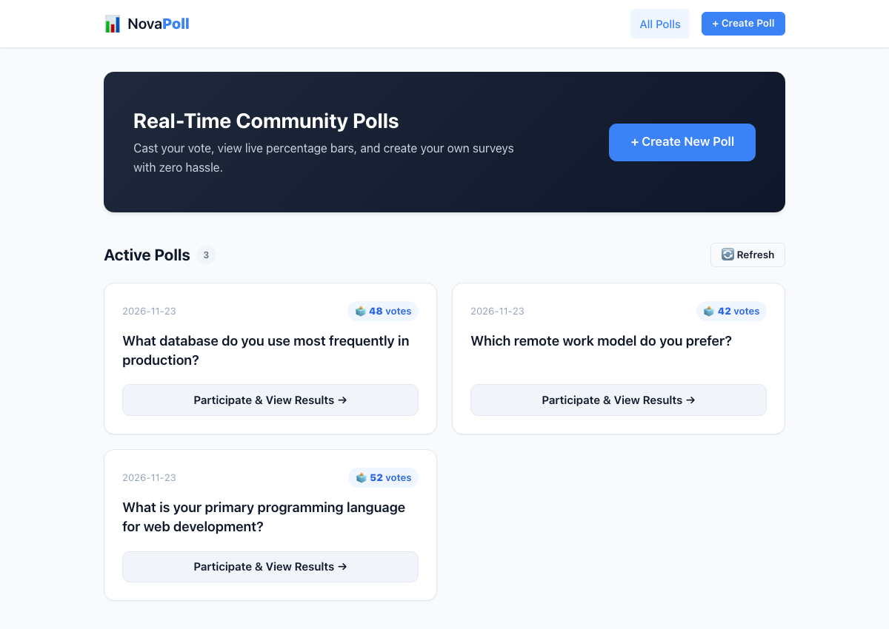
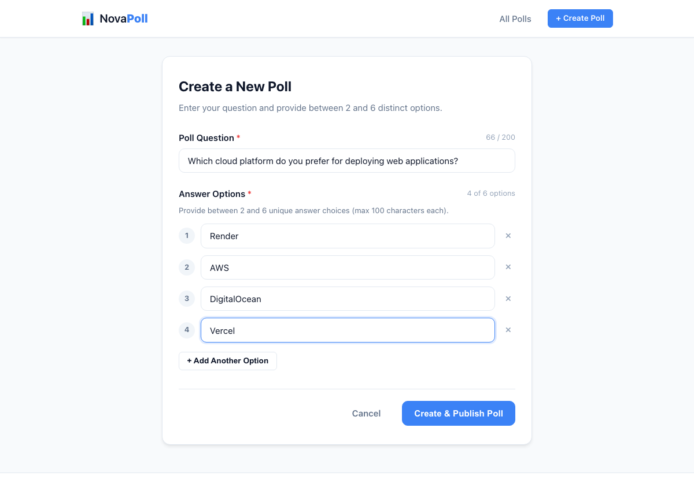
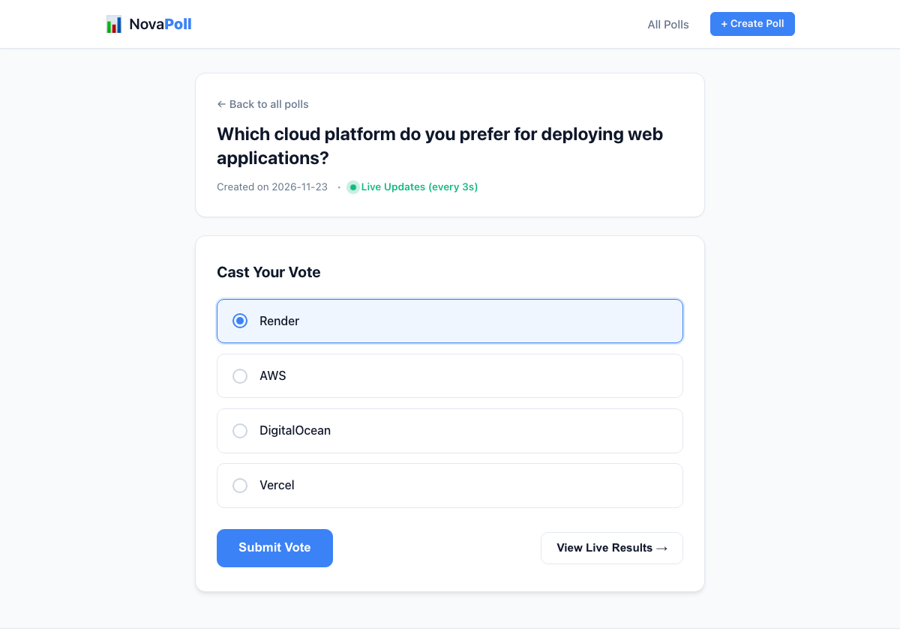
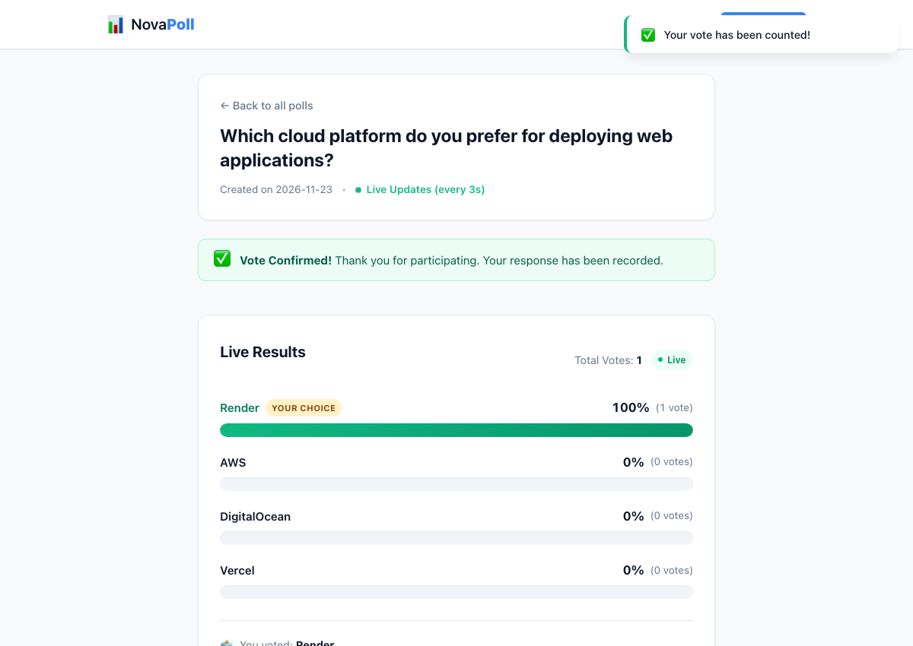
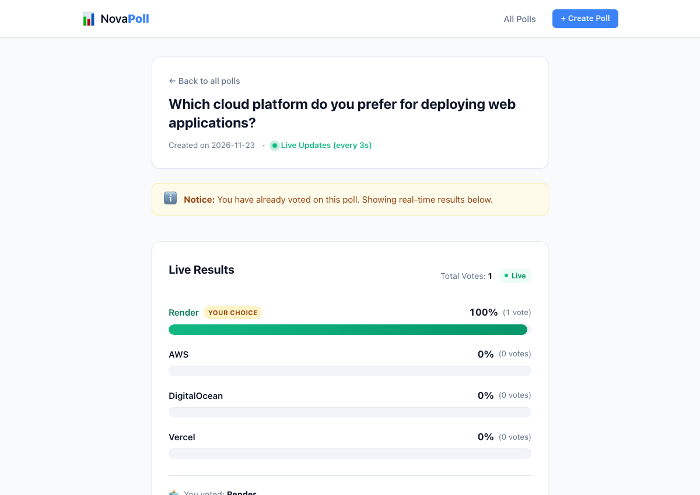
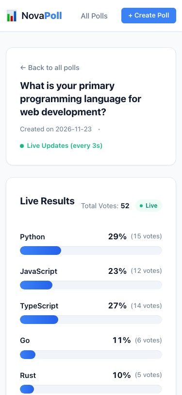

# Real-Time Polling & Survey Platform

[](https://www.python.org/downloads/release/python-396/)
[](https://flask.palletsprojects.com/)
[](https://www.sqlite.org/)
[](LICENSE)

A lightweight, real-time polling and survey web application built for the **CodeNova Full Stack Development Internship (Batch 02, Task 3)**. The application allows users to create custom polls with dynamic options, cast votes with robust duplicate vote prevention, and watch live results update via background polling with smooth, mathematically guaranteed 100% percentage distribution bars.

Built strictly with 100% free, standard tools: Python 3.9, Flask, built-in SQLite3, and vanilla HTML5, CSS3, and JavaScript with **zero build step and zero npm dependencies**.

---

## Table of Contents
1. [Key Features](#key-features)
2. [Tech Stack](#tech-stack)
3. [Architecture Overview & Folder Structure](#architecture-overview--folder-structure)
4. [Database Schema](#database-schema)
5. [Duplicate Vote Prevention Logic & Limitations](#duplicate-vote-prevention-logic--limitations)
6. [Percentage Calculation (Largest-Remainder Method)](#percentage-calculation-largest-remainder-method)
7. [REST API Reference](#rest-api-reference)
8. [Local Development Setup](#local-development-setup)
9. [Seed Data](#seed-data)
10. [Deployment Guide (Render Free Tier)](#deployment-guide-render-free-tier)
11. [Screenshots](#screenshots)

---

## Key Features

- **Dynamic Poll Creation**: Clean form allowing one question (up to 200 characters) and 2 to 6 custom answer options (up to 100 characters each). Add and remove option fields dynamically on the client side with instant validation.
- **Home Poll Explorer**: Displays all existing polls with creation dates and total vote counts, each linking directly to its voting/results page.
- **Public Voting Page (`/poll/<id>`)**: Custom styled radio-button choices with immediate visual confirmation upon submission (success feedback, selected option highlighted, and transition to live results view).
- **Live Results with Real-Time Polling**: Horizontal progress bars displaying vote counts and percentage shares. Live updates automatically poll `GET /api/polls/<id>/results` every 3 seconds via `fetch()` without any page reloads or DOM flickering.
- **Robust Duplicate Vote Prevention**: Dual-layer verification utilizing long-lived `voter_token` cookies (`HttpOnly`, `SameSite=Lax`) and salted SHA-256 client IP hashing (`IP_HASH_SALT`). Configurable via `ENFORCE_IP_LIMIT`.
- **Guaranteed 100% Percentage Sum**: Uses the Hare-Niemeyer (Largest Remainder) algorithm so option percentages always sum to exactly 100% (or 0% when no votes exist).
- **Mobile-First Responsive Design**: Responsive layout engineered with CSS flexbox and grid, tested down to 360px mobile viewports with smooth bar-width CSS transitions.
- **Accessible User Feedback**: Non-blocking toast notifications and inline warning/error banners (no browser `alert()`).

---

## Tech Stack

| Layer | Technology | Details |
|---|---|---|
| **Backend** | Python 3.9.6, Flask 3.0.3 | Minimalistic REST API + Jinja2 server-rendered views |
| **Database** | SQLite3 (Built-in) | Relational schema with foreign keys (`PRAGMA foreign_keys=ON`) |
| **Configuration** | `python-dotenv 1.0.1` | Environment-based configuration via `.env` |
| **Production WSGI** | `gunicorn 22.0.0` | Production WSGI HTTP server |
| **Frontend** | Vanilla HTML5, CSS3, JavaScript | Zero build step, zero npm, modern responsive UI |

---

## Architecture Overview & Folder Structure

```
realtime-polling-platform/
├── app.py                 # Flask application factory, web routes, REST API, error handlers
├── db.py                  # SQLite connection helper, teardown, and schema execution
├── schema.sql             # Relational table definitions, foreign keys, cascade deletes, indexes
├── seed.py                # Idempotent seed script inserting 3 sample polls and simulated votes
├── capture_and_verify.py  # Automated Playwright test and screenshot generator
├── requirements.txt       # Pinned production dependencies (Flask, python-dotenv, gunicorn)
├── Procfile               # Deployment entrypoint (web: gunicorn app:app)
├── .env.example           # Template for environment variables
├── .env                   # Local environment file (ignored by Git)
├── .gitignore             # Ignores .env, *.db, venv/, __pycache__/
├── README.md              # Comprehensive project documentation
├── static/
│   ├── css/
│   │   └── style.css      # Mobile-first CSS, custom variables, smooth bar transitions
│   └── js/
│       └── app.js         # Dynamic option builder, vote handler, 3s results polling, toasts
├── templates/
│   ├── base.html          # Base layout, navbar, toast container, footer
│   ├── index.html         # Poll listing page with vote counters
│   ├── create.html        # Dynamic poll creation form with client validation
│   └── poll.html          # Public voting form + live horizontal bar results view
└── screenshots/           # Verification screenshots
    ├── 01-create-poll.png
    ├── 02-vote-casting.png
    ├── 03-results-view.png
    ├── 04-duplicate-vote-notice.png
    └── 05-mobile-view.png
```

---

## Database Schema

The database leverages SQLite's relational integrity with foreign keys enabled (`PRAGMA foreign_keys = ON;`).



### Constraints & Indexes
- `UNIQUE(poll_id, voter_token)`: Ensures that a client with a given browser cookie token cannot vote more than once on the same poll.
- `UNIQUE(poll_id, ip_hash)`: Enforces that the same IP cannot cast multiple votes on the same poll when IP limiting is active.
- Indexes: `idx_options_poll_id`, `idx_votes_poll_id`, `idx_votes_option_id` for quick joins and vote counting aggregations.

---

## Duplicate Vote Prevention Logic & Limitations

### How It Works
1. **Voter Token Cookie**: On a visitor's very first HTTP request, Flask's `@app.before_request` and `@app.after_request` hooks assign a cryptographically random UUIDv4 cookie named `voter_token`. The cookie is marked `HttpOnly` and `SameSite=Lax` with an expiration of 1 year.
2. **Hashed Client IP**: The server extracts the client's public IP (respecting the `X-Forwarded-For` header from reverse proxies such as Render or Nginx) and computes:
   $$\text{ip\_hash} = \text{SHA-256}(\text{client\_ip} + \text{":"} + \text{IP\_HASH\_SALT})$$
   Raw IP addresses are **never** stored in the database, preserving user privacy.
3. **Dual Verification Check**: When submitting a vote to `POST /api/polls/<id>/vote`:
   - The server queries `votes` for existing records matching `poll_id` and `voter_token`.
   - If `ENFORCE_IP_LIMIT=true` (the default), it also queries for matching `ip_hash`.
   - If either matches, the vote is immediately rejected with HTTP status **409 Conflict** and the JSON payload `{"error": "You have already voted on this poll"}`.
   - The rejected attempt does **not** alter vote totals or modify existing records.
   - The client UI captures the 409 status and renders a non-intrusive warning notice: *"You have already voted on this poll. Showing real-time results below."*

### Practical Limitation (Shared Networks)
- **Shared IP Limitation**: In environments where multiple distinct devices share a single outbound public IP (such as university dorms, corporate office Wi-Fi, or cellular carrier-grade NAT), the IP check would prevent legitimate secondary users on that network from voting on the same poll once someone else on that network has voted.
- **Configurable Toggle**: For deployments in such environments, administrators can set `ENFORCE_IP_LIMIT=false` in the `.env` file. In this mode, duplicate prevention relies solely on the browser `voter_token` cookie, allowing different users on the same Wi-Fi network to vote independently while still preventing repeated votes from the same browser.

---

## Percentage Calculation (Largest-Remainder Method)

Standard floating-point rounding (e.g., standard `round()`) often results in percentages that sum to 99% or 101% due to rounding discrepancies (e.g., 3 options with 1 vote each: $33.33\% \to 33\% + 33\% + 33\% = 99\%$).

To guarantee that displayed percentages always sum to **exactly 100%**:
1. If $\text{total\_votes} == 0$, all options are assigned `0%`.
2. For each option $i$, calculate its exact percentage:
   $$P_i = \left(\frac{\text{votes}_i}{\text{total\_votes}}\right) \times 100$$
3. Take the integer floor $F_i = \lfloor P_i \rfloor$ and remainder $R_i = P_i - F_i$.
4. Compute the unallocated percentage points:
   $$D = 100 - \sum F_i$$
5. Sort options descending by remainder $R_i$ (using option index as a stable tie-breaker).
6. Distribute $+1\%$ to the top $D$ options.
7. Return exact integer percentages summing to 100%.

---

## REST API Reference

All API routes return JSON and are grouped under `/api`.

| Method | Endpoint | Request Body | Success Response | Error Responses | Description |
|---|---|---|---|---|---|
| `GET` | `/api/polls` | *None* | `200 OK`<br>`[{id, question, created_at, total_votes}, ...]` | `500 Internal Error` | List all polls with vote totals |
| `POST` | `/api/polls` | `{"question": str, "options": [str, ...]}` | `201 Created`<br>`{"id": 4, "question": "...", "message": "..."}` | `400 Bad Request`<br>Invalid question / < 2 or > 6 options / duplicates | Create a new poll |
| `GET` | `/api/polls/<id>` | *None* | `200 OK`<br>`{"id": 1, "question": "...", "options": [...], "has_voted": bool}` | `404 Not Found` | Fetch single poll details and user voting status |
| `POST` | `/api/polls/<id>/vote` | `{"option_id": int}` | `200 OK`<br>`{"message": "Vote recorded successfully."}` | `400 Bad Request`<br>Invalid option ID<br>`404 Not Found`<br>Poll missing<br>`409 Conflict`<br>Duplicate vote | Cast a vote on a poll |
| `GET` | `/api/polls/<id>/results` | *None* | `200 OK`<br>`{"poll_id": 1, "total_votes": 52, "has_voted": bool, "results": [...]}` | `404 Not Found` | Fetch live results with percentages and vote counts |

### Server-Side Validation Rules
- **Question**: String, required, stripped of whitespace, minimum 1 character, maximum 200 characters.
- **Options**: Array of strings, between 2 and 6 items. Each item must be a non-empty string of maximum 100 characters. Duplicate options (case-insensitive) are rejected with HTTP 400.
- **Option ID**: Must be an integer and must belong to the requested poll ID.

---

## Local Development Setup

### Prerequisites
- macOS or Linux
- Python 3.9+ (tested on Python 3.9.6)
- Git

### Step-by-Step Instructions

1. **Clone the repository**:
   ```bash
   git clone <your-repo-url>
   cd realtime-polling-platform
   ```

2. **Create and activate a virtual environment**:
   ```bash
   python3 -m venv venv
   source venv/bin/activate
   ```

3. **Install dependencies**:
   ```bash
   pip install -r requirements.txt
   ```

4. **Configure environment variables**:
   ```bash
   cp .env.example .env
   ```
   *(Optionally edit `.env` to change `PORT` or secret keys)*

5. **Initialize database & seed sample data**:
   ```bash
   python seed.py
   ```
   *The seed script creates the SQLite tables if needed and loads 3 sample polls with realistic initial votes. It is completely safe to run multiple times (idempotent).*

6. **Start the application**:
   ```bash
   python app.py
   ```
   *Or using Flask CLI:*
   ```bash
   flask --app app run --port 5000
   ```

7. **Open in browser**:
   Navigate to [http://127.0.0.1:5000](http://127.0.0.1:5000)

---

## Seed Data

Running `python seed.py` provisions the database with three realistic sample polls:
1. *"What is your primary programming language for web development?"* (Python, JavaScript, TypeScript, Go, Rust) - 52 initial votes
2. *"Which remote work model do you prefer?"* (Fully Remote, Hybrid, In-Office Full Time) - 42 initial votes
3. *"What database do you use most frequently in production?"* (PostgreSQL, MySQL, SQLite, MongoDB, Redis) - 48 initial votes

The seed script checks for existing questions before inserting and will not duplicate polls or votes if executed repeatedly.

---

## Deployment Guide (Render Free Tier)

This platform is configured for instant deployment on [Render](https://render.com) Web Services.

### 1. Build and Start Settings
- **Environment**: Python
- **Build Command**:
  ```bash
  pip install -r requirements.txt && python seed.py
  ```
- **Start Command**:
  ```bash
  gunicorn app:app
  ```
  *(Specified in the included `Procfile`)*

### 2. Environment Variables on Render
Add the following in your Render service's **Environment** tab:
| Key | Sample Value | Note |
|---|---|---|
| `SECRET_KEY` | `generate-a-strong-random-secret` | Flask session and cookie signing |
| `DATABASE_PATH` | `polling.db` | Relative path to SQLite file |
| `IP_HASH_SALT` | `generate-a-random-salt-string` | Salt for hashing client IPs |
| `ENFORCE_IP_LIMIT` | `true` | Set to `false` if users share an IP |
| `FLASK_ENV` | `production` | Production environment mode |

> [!WARNING]
> **Ephemeral Storage Notice on Render Free Tier**:
> Render's free Web Service tier operates on ephemeral storage. Any changes to the SQLite database (`polling.db`) will reset whenever the free instance spins down due to inactivity or restarts upon a new deployment. For long-term persistent production storage, attach a Render Persistent Disk (available on paid plans) or connect to an external hosted PostgreSQL instance.

---

## Screenshots

### 1. Home Page
Live community poll explorer displaying real-time vote totals and active poll cards:


---

### 2. Poll Creation Form
Dynamic option builder allowing 2 to 6 unique choices with live character count:


---

### 3. Public Vote Casting
Accessible radio button selection with modern cards and responsive layout:


---

### 4. Live Results View
Horizontal percentage bars with smooth transitions, largest-remainder math, and personal vote highlight:


---

### 5. Duplicate Vote Notice
Friendly alert and 409 rejection when attempting to vote a second time, leaving vote counts unchanged:


---

### 6. Mobile View (375px)
Fluid responsive layout optimized for mobile screens:


---

## License

This project is licensed under the MIT License. Developed for the CodeNova Internship Program (Batch 02, Task 3).
